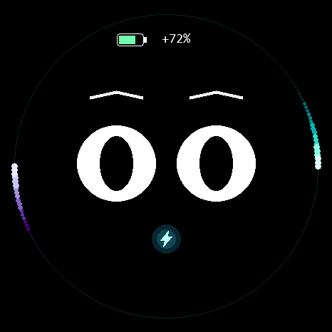

# STACH

[Русский](README.md) · [English](README.en.md) · [简体中文](README.zh-CN.md) · **繁體中文** · [Español](README.es.md) · [हिन्दी](README.hi.md) · [العربية](README.ar.md) · [Français](README.fr.md) · [বাংলা](README.bn.md) · [Português](README.pt.md) · [Bahasa Indonesia](README.id.md) · [اردو](README.ur.md) · [Deutsch](README.de.md) · [日本語](README.ja.md) · [한국어](README.ko.md) · [Türkçe](README.tr.md) · [Tiếng Việt](README.vi.md) · [Italiano](README.it.md) · [فارسی](README.fa.md) · [Polski](README.pl.md) · [Українська](README.uk.md)

STACH 將 **Waveshare ESP32-S3-Touch-AMOLED-1.75** 變成袖珍伴侶。它的眼睛跟隨您的手指並對傾斜做出反應。向右滑動即可玩遊戲，或使用手機更改其表情、亮度、行為和顯示名稱。該主機板擁有自己的 Wi-Fi 網路和控制面板。


**充電動畫**



## 在 Waveshare 1.75 上安裝

這些指令在 Windows 上使用 `stach-eyes-175` PlatformIO 環境進行了測試。它從 `src/main.cpp` 構建完整的應用程式，用於圓形 466 × 466 CO5300 顯示屏、16 MB 快閃記憶體和 8 MB PSRAM。刷機前請檢查開發板或其包裝上的型號。 1.43、1.43B 和 1.75C 修訂版具有不同的硬體。

### 1. 準備你的電腦

首次構建需要帶有 `py` 啟動器的 Python 3.13、Windows 版 Git、USB 資料線和網際網路連線。 [適用於 Windows 的 Python](https://www.python.org/downloads/windows/) · [適用於 Windows 的 Git](https://git-scm.com/downloads/win)

開啟 PowerShell 並將專案克隆到新資料夾中。包含 ASCII 字元的短路徑適用於 ESP32 工具。

```powershell
cd $env:USERPROFILE
git clone https://github.com/leonidgg2323-code/stach.git stach-firmware
cd stach-firmware
py -3.13 -m venv .venv
.\.venv\Scripts\python.exe -m pip install "platformio==6.2.0"
```

也可以在 GitHub 上選擇 **Code → Download ZIP** 並解壓存檔。在包含 `platformio.ini` 的資料夾中開啟 PowerShell 並執行上面的最後兩個命令。下面的命令直接呼叫虛擬環境的Python。

### 2. 安裝依賴項並構建

```powershell
.\.venv\Scripts\python.exe -m platformio pkg install -e stach-eyes-175
.\.venv\Scripts\python.exe -m platformio run -e stach-eyes-175
```

第一個構建會下載 ESP32 工具鏈，可能需要幾分鐘的時間。該版本會自動應用藍芽滑鼠庫相容性補丁。等待 `stach-eyes-175  SUCCESS` 後再上傳。

### 3. 找到串列埠並燒寫板子

透過 USB 連線開發板並列出可用埠。

```powershell
.\.venv\Scripts\python.exe -m platformio device list
```

識別插入板時出現並拔出板時消失的埠。將示例中的 `COM3` 替換為您的埠。關閉所有使用它的程式，包括 Arduino IDE 串列埠監視器。

**上傳替換板上的韌體。** 要保留恢復出廠選單的選項，請在上傳之前在儲存庫外部儲存完整快閃記憶體備份。該模型的完整備份是 **16,777,216 位元組**。如果您已有備份，請使用新的檔名。該影象可能包含設定和憑據，因此請保密。

```powershell
.\.venv\Scripts\python.exe -m pip install "esptool>=5,<6"
.\.venv\Scripts\python.exe -m esptool --chip esp32s3 --port COM3 read-flash 0 ALL "$env:USERPROFILE\stach-before-install.flash-backup.bin"
```

要安裝 STACH，請執行上傳命令。

```powershell
.\.venv\Scripts\python.exe -m platformio run -e stach-eyes-175 -t upload --upload-port COM3
```

校驗和檢查和 `SUCCESS` 訊息後，板重新啟動。 PlatformIO 將引導載入程式、分割槽表和應用程式寫入各自的地址。構建目錄中的 `firmware.bin` 檔案僅包含應用程式。

### 4. 註冊裝置所有者賬號

1. 首次啟動時，用手機掃描 **1/2 JOIN WI-FI**。加入 `Stach-XXXXXX` 網路。如果您的手機報告無法訪問網際網路，請選擇 **保持連線**。
2. 手機連線後，顯示切換為 **2/2 REGISTER**。如果仍然顯示第一個程式碼，請點選顯示屏一次。使用同一部手機掃描第二個程式碼。
3. 選擇由 3-32 個字母（A-Z 或 a-z）、數字、連字元或下劃線組成的使用者名稱，以及至少 12 個字元的密碼。儲存您的登入詳細資訊。帳戶和設定儲存在板上。
4. 在 **Аккаунт владельца** （所有者帳戶）中，您可以更改面板中顯示的名稱或登出。如需稍後訪問，請連線主機板的 Wi-Fi 並開啟 [本地 STACH 控制面板](http://192.168.4.1/)。

每塊開發板只能註冊一個所有者賬號。註冊需要物理顯示器上顯示的一次性程式碼。控制命令需要所有者會話和請求令牌。該面板在開發板的本地 Wi-Fi 網路上使用 HTTP。待開發板重啟後再次登入。

## 手勢和遊戲

| 行動 | 結果 |
|---|---|
| 觸控眼睛或傾斜開發板 | 眼睛跟隨您的手指或傾斜。 |
| 在眼睛介面向右滑動 | 開啟遊戲選單。 |
| 在遊戲中向左滑動 | 返回選單。再次向左滑動即可返回眼睛。 |
| 按住眼睛螢幕約一秒鐘 | 顯示 Wi-Fi 二維碼。點選可在網路程式碼和麵板程式碼之間切換。按住即可返回眼睛。 |
| 在眼睛介面向上滑動 | 啟動藍芽滑鼠模式。與計算機上的 **Stach Mouse** 配對並保持電路板靜止以進行校準。 |
| 在滑鼠模式下觸控式螢幕幕 | 點選左鍵單擊、雙擊右鍵單擊、滑動滾動或按住退出。 |

在 **Targets** 中，在 20 秒內擊中儘可能多的目標。在 **Sums** 中，回答五道加法題。這兩款遊戲都會顯示您的分數並儲存您的個人最好成績。 **Dice** 擲六面骰子， **Coin** 擲硬幣。每個結果都來自 ESP32 硬體隨機數生成器。動畫完成後再次點選即可進行再次擲骰子或拋硬幣。

## 顯示及電源

手機面板包括表情選擇、注視操縱桿、眨眼和傾斜控制、眼睛亮度以及眼睛自行移動量的設定。外觀設定在重新啟動後仍然保留。您可以在啟動後啟用滑鼠模式。

在 1.75 板上， **AXP2101** 報告電池百分比和充電狀態。當開發板使用電纜電源執行且檢測到沒有電池時，指示燈顯示 `USB`。啟用省電功能後，眼睛重新整理率會在 45 秒不活動後下降，螢幕會在 5 分鐘後關閉。當檢測到的電量為 15% 或更少時，這些間隔會降至 10 秒和 2 分鐘。觸控式螢幕幕將其喚醒。遊戲、二維碼、滑鼠模式和主動充電使顯示屏保持喚醒狀態。

## 故障排除和恢復

| 症狀 | 處理方法 |
|---|---|
| 沒有出現新的COM埠 | 嘗試使用 USB 資料線和另一個 USB 埠，然後再次執行 `platformio device list`。 |
| 埠打不開或者報 `Access denied` | 關閉串列埠監視器。重新連線板並檢查其 COM 號。 |
| 構建失敗 | 檢查當前資料夾是否包含 `platformio.ini`，然後重複步驟 2 中的兩個命令。 |
| 螢幕保持空白 | 檢查上傳日誌中的開發板型號和環境名稱。對於 1.75 板，成功行應包括 `stach-eyes-175`。 |
| 手機打不開面板 | 檢查它是否仍在 `Stach-XXXXXX` 上並開啟 `http://192.168.4.1/`。首次註冊需要第二個二維碼。 |

要檢視診斷資訊，請以 115200 波特率開啟串列埠監視器。

```powershell
.\.venv\Scripts\python.exe -m platformio device monitor -p COM3 -b 115200
```

傳送 `I` 獲取硬體初始化報告，傳送 `S` 列出 I²C 裝置，或傳送 `D` 進行五秒顯示測試。按 **Ctrl+C** 關閉監視器。

要將完整備份恢復到原開發板，請先關閉串列埠監視器，並核對備份檔案大小。以下命令還會恢復備份中包含的設定和帳戶資料。

```powershell
.\.venv\Scripts\python.exe -m esptool --chip esp32s3 --port COM3 write-flash 0x0 "$env:USERPROFILE\stach-before-install.flash-backup.bin"
```

**需要幫助嗎？** 在 Discord 上聯絡 `twiinkprostolox123` 或 [@def0kk (Telegram)](https://t.me/def0kk)。包括開發板型號、 PlatformIO 環境以及錯誤資訊。請勿公開密碼、註冊二維碼或完整的快閃記憶體備份。

## 專案歷史及發展

- **第 9 階段 — 功率。** 較舊的 1.43 配置檔案測量和過濾 GPIO4 上的 ADC 電壓。估算電量需要檢查原理圖的具體版本並根據測量的電池電壓進行校準。僅 接入 USB 電源不代表電池正在充電。 1.75配置檔案直接讀取AXP2101。
- **第 10 階段 — 模式和個性化。** 從顯示屏或透過 `POST /api/mode` 在面部、藍芽滑鼠、Wi-Fi QR 和麵板 QR 之間切換。眼睛亮度和注視活動範圍從 20% 到 100%。 BLE 滑鼠控制需要硬體配置檔案。
- **第 11 階段 — 可靠性和安全性。** 韌體檢查 HTTP 請求來源、使用請求令牌保護命令、限制請求速率並恢復 Wi-Fi 接入點。 1.75 配置檔案還需要所有者登入。 [第 11 階段安全說明](STAGE11-SECURITY.md)
- **第 12 階段 — 構建和診斷。** GitHub Actions 檢查程式碼，併為打包後的構建產物生成校驗和。 `GET /api/hardware` 報告軟體初始化結果。顯示輸出、觸控響應和配對可以在物理板上進行測試。 [構建和釋出](STAGE12-RELEASE.md) · [硬體測試](STAGE12-HARDWARE-TESTS.md) · [硬體診斷](STAGE2-HARDWARE-DIAGNOSTICS.md)

韌體入口點是 `src/main.cpp`。標頭位於 `include/`，控制面板源為 `web/stach-panel.html`。編輯面板後，更新 `preview/stach-panel.html` 以匹配，然後執行  `python tools/build_web_header.py`。執行 `python tools/check_panel.py` 來檢查嵌入的頁面和API契約（需要Node.js）。在 Linux 上，執行 `sh tools/test_core.sh` 進行可移植核心測試。執行 `python tools/test_ble_patch.py` 檢查BLE補丁相容性。

STACH 是一個獨立專案，靈感來自 Pip-KeyPet 流派。 PlatformIO 安裝第三方庫，專案對 ESP32 BLE Mouse 0.3.1 應用了相容性補丁。 [Waveshare 1.75 資源](https://github.com/waveshareteam/ESP32-S3-Touch-AMOLED-1.75) · [Waveshare 1.43參考](https://www.waveshare.com/wiki/ESP32-S3-Touch-AMOLED-1.43)
